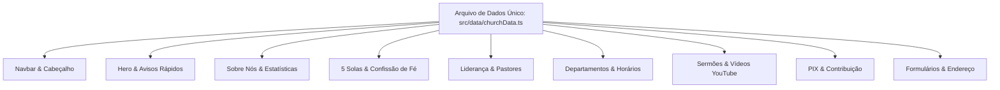

# 📐 Plano de Implementação: Portal Oficial ICE Cohatrac

> **Status:** Pronto para Execução & Validação  
> **Referência de Benchmark:** Portal Oficial da ICE Timon (`icetimon.com.br` — AICEB)  
> **Documento Base:** `especifica_o_para_o_antigravity_site_ice_cohatrac.md`  
> **Diretriz de Design:** Sóbrio, reverente, institucional, modular e **100% livre de imagens ou estética artificial de IA**.

---

## 1. Visão Executiva & Benchmark (ICE Timon)

Ao analisar a estrutura e a excelência visual do portal de referência **ICE Timon** (`icetimon.com.br`), foram identificados os padrões mais fortes adotados pelas igrejas da **AICEB** (Aliança das Igrejas Cristãs Evangélicas do Brasil):

| Elemento Analisado | Padrão ICE Timon (`icetimon.com.br`) | Aplicação no Projeto ICE Cohatrac |
| :--- | :--- | :--- |
| **Tipografia** | Contraste refinado entre fonte com serifa para títulos bíblicos (`Newsreader`/`Bricolage`) e sem serifa para UI (`Inter`/`DM Sans`). | `Merriweather` (sacralidade, peso histórico) para títulos e `Plus Jakarta Sans` para textos de leitura fluida. |
| **Paleta de Cores** | Azul Profundo (`#0A1E36`), Azul Royal, Creme Suave (`#FDF8EC`) e Âmbar/Dourado (`#C89B3C`). | Paleta institucional rigorosamente calibrada com variáveis CSS centralizadas no `:root`. |
| **Agenda Interativa** | Calendário mensal com marcação de cultos regulares e eventos especiais com contagem regressiva. | Grade semanal completa de cultos com marcadores visuais de transmissão ao vivo e eventos. |
| **Departamentos** | Abas interativas com foto/ícone, descrição, horário e público-alvo. | Grid modular de 6 ministérios com dados centralizados em TypeScript. |
| **Acervo de Sermões** | Pregações expositivas com identificação de passagem e pregador. | Player principal com troca dinâmica de cultos reais do canal `@ICECOHATRAC` (+750 vídeos). |
| **Dízimos & PIX** | Chave CNPJ destacada, botão de cópia rápida com toast e QR Code. | Card oficial do PIX (CNPJ `05.349.364/0001-03`) com cópia em 1 clique e feedback instantâneo. |

---

## 2. Princípios de Design "Anti-IA" (Design Humano e Institucional)

Para garantir que o site tenha um visual sóbrio, respeitoso e profissional, longe de aparências genéricas ou caricatas de inteligência artificial:

1. **Zero Imagens Geradas por IA:** 
   - Proibição absoluta de artes geradas por modelos generativos.
   - Utilização de **fallbacks estruturados em SVG vetorial limpo** (ícones de Bíblia Sagrada, Cruz Reformada, Marcadores de Mapa e QR Code).
   - Espaços reservados com proporções exatas (`h-12`, `w-40 h-40`, etc.) com tratamento de erro `onError` para carregar automaticamente as fotos reais que a liderança da igreja inserir em `public/assets/img/`.
2. **Espaçamento e Tipografia Dignos de Igreja Histórica:**
   - Hierarquia clara de leitura, sem efeitos exagerados ou cores fluorescentes.
   - Uso de bordas sutis em tons de dourado sóbrio (`rgba(200, 155, 60, 0.35)`) e azuis institucionais.
3. **Micro-interações Funcionais:**
   - Feedback imediato de cópia de chave PIX.
   - Accordion acessível para os Artigos de Fé.
   - Alternância de abas em formulários sem recarregamento da página.
   - Troca de vídeo no player do YouTube diretamente no cliente.

---

## 3. Arquitetura Modular para Fácil Manutenção Futura

Um dos requisitos centrais do usuário é a **facilidade para alterar, adicionar ou remover conteúdos no futuro sem quebrar o layout**. 

Para isso, toda a inteligência de conteúdo do site é desacoplada da camada visual:



### O que o desenvolvedor ou a equipe da igreja pode alterar em 1 minuto em `src/data/churchData.ts`:
- **Adicionar/remover um culto ou mudar horário:** basta editar a lista `schedule`.
- **Atualizar o vídeo em destaque ou adicionar novos sermões:** basta incluir o ID do YouTube na lista `sermons`.
- **Alterar pastores, presbíteros ou diáconos:** basta alterar a lista `leaders`.
- **Atualizar chave PIX ou dados bancários:** basta alterar o objeto `giving`.
- **Alterar links de redes sociais ou WhatsApp:** basta alterar o objeto `socials`.

---

## 4. Fases de Execução do Plano

### Fase 1: Fundação, Tokens e Tipografia
- [x] Configuração do Next.js 16 com TypeScript e App Router.
- [x] Declaração das variáveis de cores no `src/app/globals.css`.
- [x] Inclusão das fontes Google (`Merriweather` e `Plus Jakarta Sans`).
- [x] Instalação e isolamento de ícones SVG (`lucide-react` e `SocialIcons.tsx`).
- [x] Remoção completa de qualquer imagem sintética / IA.

### Fase 2: Componentes Estruturais e Interatividade
- [x] **Navbar:** Suporte a logo real com fallback elegante de Bíblia Sagrada em dourado; menu mobile funcional; botão com pulso vermelho para cultos ao vivo.
- [x] **Hero:** Gradiente institucional Azul Noite com títulos oficiais e barra de acesso rápido (EBD 09h, Culto 18h, Terça 19h30).
- [x] **Sobre a Igreja:** História da ICE Cohatrac desde 2002, tradição da AICEB desde 1947, dados jurídicos (CNPJ) e moldura institucional para a logo.
- [x] **Confissão de Fé & 5 Solas:** Cards institucionais dos 5 Solas em Azul Marinho e Dourado + Accordion interativo com os artigos doutrinários da AICEB.
- [x] **Corpo Pastoral e Governo:** Cards do Pr. Madson Oliveira, Pr. Mário Rúbens, Ev. Daniel e explicação bíblica do Presbitério e Diaconato.
- [x] **Departamentos:** 6 áreas ministeriais com ícones, propostas e horários de reuniões.
- [x] **Programação Semanal:** Grade completa com destaque solene para os cultos de domingo.
- [x] **Sermões & YouTube:** Player dinâmico interativo conectado aos IDs reais do canal `@ICECOHATRAC` com seletor de vídeos sem reload.
- [x] **Dízimos & Ofertas:** Versículo 2 Co 9:7, card de PIX com chave CNPJ oficial, botão "Copiar Chave" com feedback de Toast e espaço para QR Code.
- [x] **Contato & Localização:** Abas interativas para *Pedido de Oração* e *Planeje sua Visita*, com envio para rotas de API dedicadas e mapa interativo do Cohatrac / Parque Aurora.
- [x] **Rodapé Institucional:** Links de navegação, dados jurídicos e selo *Soli Deo Gloria*.

### Fase 3: Backend & Rotas de API Dinâmicas
- [x] Criar endpoint `POST /api/pedidos-oracao` com validação de dados e resposta estruturada.
- [x] Criar endpoint `POST /api/visitas` para registro e acolhimento de novos visitantes.

### Fase 4: Automação Linux & Deploy no Apache
- [x] Criar arquivo de VirtualHost do Apache 2.4 com suporte a Reverse Proxy (`ProxyPass` para porta 3000), WebSockets, compressão gzip e cabeçalhos de segurança em `deploy/apache-ice-cohatrac.conf`.
- [x] Criar unit do Systemd `deploy/ice-cohatrac.service` para inicialização automática no boot do Linux e auto-restart em falhas.
- [x] Criar configuração alternativa para PM2 em `ecosystem.config.js`.
- [x] Criar scripts executáveis:
  - `scripts/setup-apache.sh` (habilita módulos e virtualhost)
  - `scripts/install-service.sh` (configura e ativa serviço no boot)
  - `scripts/deploy.sh` (atualização automática via git pull e build)
- [x] Documentar todo o fluxo passo a passo no `README.md`.

### Fase 5: Versionamento Git & Sincronização no GitHub
- [x] Configuração da identidade Git (`Leinad Saia`).
- [x] Criação do repositório remoto público no GitHub: `LeinadSaia/Site-ICE-Cohatrac`.
- [x] Primeiro commit semântico com todos os arquivos de aplicação e infraestrutura.
- [x] Push completo para o branch `main`.

---

## 5. Protocolo de Verificação e Testes

Para garantir que a aplicação se mantenha estável em cada ciclo de manutenção:

```bash
# 1. Verificação de compilação e tipagem TypeScript
npm run build

# 2. Teste de execução em ambiente local
npm run start # ou npm run dev

# 3. Teste das rotas de API
curl -X POST http://localhost:3000/api/pedidos-oracao \
  -H "Content-Type: application/json" \
  -d '{"name":"Teste Visitante","phone":"98999999999","prayerReason":"Saúde da família"}'

# 4. Teste de sintaxe da configuração do Apache no Linux
sudo apache2ctl configtest

# 5. Verificação de status do serviço no Linux
sudo systemctl status ice-cohatrac.service
```

---

## 6. Próximos Passos & Personalizações Futuras Recomendadas

1. **Inserção dos Arquivos de Imagem Oficiais da Igreja:**
   - Salvar a logo real da igreja em `public/assets/img/logo-ice-cohatrac.png`.
   - Salvar a foto real da fachada ou do interior do templo em `public/assets/img/hero-bg.jpg`.
   - Salvar a imagem do QR Code do PIX gerada no banco da igreja em `public/assets/img/qrcode-pix-ice.png`.
2. **Integração de Notificações nos Formulários:**
   - Conectar o envio dos pedidos de oração diretamente a um webhook do WhatsApp ou e-mail da equipe pastoral.
3. **Subdomínio e SSL:**
   - Apontar o domínio DNS da igreja para o IP do servidor Linux e executar `sudo certbot --apache` para ativar o HTTPS.
